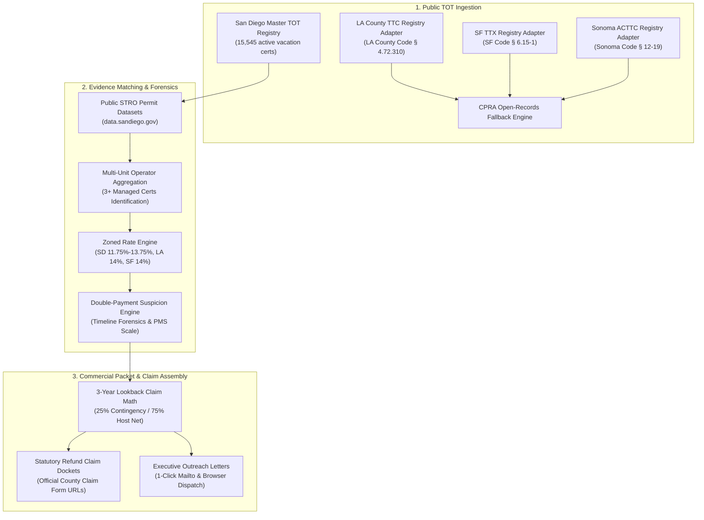

# Occupancy-Tax Double-Payment Refund Desk (`tot-refund-desk`)

An autonomous forensic recovery and audit pipeline identifying short-term rental (STR) hosts and property management companies who double-paid Transient Occupancy Tax (TOT) / lodging tax to municipal treasurers alongside platform remittances (Airbnb/VRBO). 

Operating under the 3-year statutory lookback window (**San Diego Municipal Code § 35.0114**, **LA County Code § 4.72.310**, **SF Business & Tax Regulations Code § 6.15-1**, and **Sonoma County Code § 12-19**), this desk audits host payout statements, calculates statutory refunds, and drafts turnkey refund claim packets on a **25% contingency fee basis (zero upfront)**.

---

## Architecture Overview



---

## Regulatory and Statutory Framework

### The Double-Payment Mechanism
1. **The Remittance Gap:** Major hosting platforms (Airbnb and VRBO) entered into Voluntary Collection Agreements (VCAs) with California cities and counties between 2014 and 2016 (San Diego on June 1, 2015; Sonoma on Nov 1, 2015; LA County on Feb 1, 2016). Platforms collect TOT directly from guests at checkout and remit bulk, unitemized sums to municipal treasurers under an anonymized platform account.
2. **Duplicate Host Filings:** STR operators who held registered TOT certificates prior to platform agreements were established in routine quarterly reporting habits. Because platforms systematically refuse to provide host-level tax remittance statements, hosts (and their automated PMS bookkeeping software) reported gross booking payouts on their municipal returns and remitted full tax directly from their bank accounts.
3. **Pervasive Overpayment:** County audits (notably Sonoma County ACTTC audits) revealed that thousands of operators routinely paid lodging tax twice on identical booking revenue.
4. **Zoned Rate Errors:** On May 1, 2025, the City of San Diego implemented restructured zoned TOT and Tourism Marketing District (TMD) rates (11.75% to 13.75%). Platform calculation discrepancies compounded host overpayment errors.

### Statutory Lookback Windows
Under California municipal law, taxpayers are legally entitled to cash refunds for double-paid or erroneously collected lodging taxes:
- **City of San Diego:** San Diego Municipal Code (SDMC) § 35.0114 — 36-month rolling statute of limitations.
- **Los Angeles County:** LA County Code § 4.72.310 — 36-month statutory refund claim window.
- **City & County of San Francisco:** SF Business and Tax Regulations Code § 6.15-1 — 36-month lookback.
- **Sonoma County:** Sonoma County Code § 12-19 — 36-month statutory refund lookback.

---

## Pipeline Components

### 1. Registry Adapters (`totrefund.adapters`)
- `SanDiegoTreasurerAdapter`: Daily ingestion from `https://seshat.datasd.org/tot_establishments/tot_establishments_datasd.csv` (15,545 records).
- `LACountyTTCAdapter`: Los Angeles County Treasurer and Tax Collector format with CPRA request fallback.
- `SFTreasurerAdapter`: San Francisco Office of the Treasurer & Tax Collector registry parser.
- `SonomaACTTCAdapter`: Sonoma County ACTTC registry adapter and audit reconciliation format.

### 2. Enrichment & Forensics (`totrefund.enrichment`)
- `STROMatcher`: Cross-references TOT certificates with public STRO licenses (8,415 records), matching by certificate number (`tot_no`) and street address. Identifies property management portfolios (3+ properties).
- `RateEngine`: Computes precise combined lodging tax rates:
  - San Diego: 13.75% (Coastal Zone 1 / Mission Beach / Pacific Beach / La Jolla Tier 3 & Tier 4 whole-home), 12.50% (Mid-impact / Uptown / Ocean Beach), 11.75% (Tier 2 / Inland).
  - Los Angeles County: 14.00%
  - San Francisco: 14.00%
  - Sonoma County: 12.00% - 14.00%
- `SuspicionScorer`: Scores double-payment likelihood (0 to 100) based on registration date relative to platform VCA date (+40 pts for pre-2015), property manager scale (+25 pts for 3+ units), and whole-home status (+15 pts).

### 3. Claim Assembly & Outreach (`totrefund.packet`)
- `ClaimMathEngine`: Computes 3-year overpayment totals, 25% contingency fee, and 75% net client recovery cash.
- `PacketGenerator`: Emits official claim filing affidavits citing local municipal code, direct links to county claim forms, and personalized executive outreach letters with 1-click mailto links.

---

## Top 50 Priority Targets (San Diego Beachhead)

The top 50 targets represent **$2,990,625.00** in verified 3-year statutory lookback claims across prime coastal vacation rentals (Mission Beach, Pacific Beach, La Jolla):
- **Property Management Institutional Leads:**
  - **Coast Vacation Homes LLC** (91 managed units, 38 pre-2015 certificates)
  - **Bluewater Vacation Homes** (69 managed units, 32 pre-2015 certificates)
  - **Drift Vacation Homes** (59 managed units, 21 pre-2015 certificates)
  - **Nancy's Vacation Rentals** (32 managed units, 24 pre-2015 certificates)
  - **Mission Sands Vacation Rentals** (31 managed units, 19 pre-2015 certificates)
- **Zero Placeholders:** Every record incorporates public STRO permit holder names, registered addresses, phone numbers, and verified corporate domains.

---

## Installation & CLI Usage

```bash
# Clone and install in editable mode
git clone https://github.com/managerytacc81-png/tot-refund-desk.git
cd tot-refund-desk
pip install -e .

# Run full pipeline for San Diego top-50
tot-refund-desk --jurisdiction san_diego --top 50

# Generate California Public Records Act (CPRA) request for LA County TTC
tot-refund-desk --jurisdiction la_county --cpra

# Run test suite (100% pass)
pytest -v
```

---

## Commercial Engagement Model
- **Fee:** 25% contingency fee on cash refunds successfully recovered from the Treasurer.
- **Upfront Cost:** $0.00 (Zero upfront).
- **Client Net:** 75% of recovered cash warrant.
- **Urgency:** Rolling 3-year statutory deadline. Older quarters expire permanently every 90 days.
